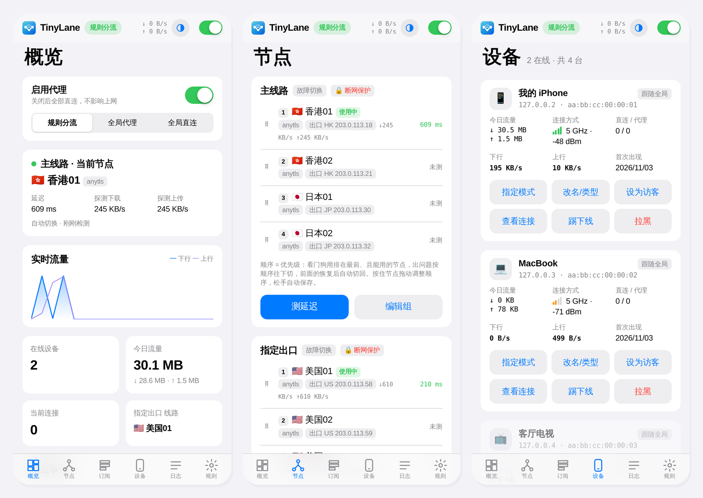

<p align="right"><a href="README.md">简体中文</a> · <b>English</b></p>

<p align="center">
  
</p>

<h1 align="center">TinyLane</h1>

<p align="center"><b>Whole-home transparent proxy for small routers · one binary, install and go</b></p>

<p align="center"><i>Runs comfortably in 256 MB of RAM: sing-box core + daemon + mobile web panel, all in a single file.</i></p>

<p align="center">
  <a href="../../releases"></a>
  <a href="LICENSE"></a>
  
  
  
  <a href="CHANGELOG.md"></a>
</p>

<p align="center">
  <a href="#who-its-for">Who it's for</a> ·
  <a href="#features">Features</a> ·
  <a href="#install">Install</a> ·
  <a href="#commands">Commands</a> ·
  <a href="#known-limitations">Limitations</a> ·
  <a href="#building">Building</a> ·
  <a href="CHANGELOG.md">Changelog</a>
</p>

<p align="center"></p>

<details>
<summary>More screenshots (Subscriptions · Rules · Settings)</summary>
<p align="center"></p>
</details>

<p align="center"><sub>Screenshots use demo data. The panel UI is currently Chinese only.</sub></p>

> Early release. The author runs it daily on a Xiaomi AX3000T (OpenWrt 25.12, 256 MB) and keeps updating it; observed resident memory is about 35 MB for the core and 20–28 MB for the panel daemon, with 77–93 MB of RAM still available (readings from one home router under normal load; not a side-by-side comparison with OpenClash). Every change is described in [CHANGELOG.md](CHANGELOG.md) (Chinese) and in the Release notes.

## Who it's for

- Your router has only 128–256 MB of RAM and OpenClash-style setups are too heavy;
- You want every device at home (TVs, consoles, guests' phones) routed automatically, without installing an app on each one;
- You want to see from your phone which line you're on, which device is using bandwidth, and whether a site went through the proxy or direct.

## Features

### 1. Three modes

Switch from the top of the panel:

| Mode | Effect |
|---|---|
| Rule (default) | Mainland China sites and IPs go direct; everything else follows your rules |
| Global proxy | Everything goes through the main group, except rules marked "pinned" |
| Global direct | Proxy idle; behaves like a plain router |

Turning off "Enable proxy" sends every device direct; the router itself keeps working.

### 2. Nodes, subscriptions and groups

- **Subscriptions**: paste a URL. Supports Clash YAML, sing-box JSON, share links / Base64; protocols include Hysteria2, VLESS (Reality, WS+TLS), AnyTLS and more. Daily or weekly auto-update, with a preview of added/removed nodes before applying. Fake "info" nodes (remaining traffic, expiry date) are filtered by keyword.
- **Manual nodes**: paste a single share link.
- **Exit detection**: each node's real exit region is detected and shown next to it.
- **Groups**: hand-picked nodes + "auto-include names containing X" + "exclude names containing X". Membership is recomputed when subscriptions change.
- **Failover**: nodes in a group are ordered by priority; a watchdog checks latency and download speed, switches to the next node on failure and back on recovery, and won't flap when your own uplink is down. You can also pin a node manually.
- **Kill switch per group**: when every node in the group is down, traffic for that group is dropped instead of leaking direct or through another line. Useful for sites that must be reached from a specific region.

### 3. Rule-based routing

- **Custom rules**: match by domain, suffix, keyword, IP range, port or source device; send to any group, direct, or block. Drag to reorder; "pinned" rules also apply in global proxy mode.
- **Remote rule sets**: `.srs` and sing-box source `.json`, auto-updated on a schedule.
- **Quick rules**: tap a site in the connection list to add "always direct" or "always via group X".
- **Kernel-level direct for China IPs**: China IPs bypass the proxy core at the firewall, saving CPU and keeping speeds steady.
- **Import**: paste Clash rule lines, domain lists or a whole config, preview, then choose the target group.

### 4. Devices

- Auto-discovers LAN devices with type, online / sleeping / offline status, Wi‑Fi signal and today's traffic (direct traffic included).
- Per-device mode (needs a static IP):
  - follow global / global proxy / global direct;
  - **China direct, everything else via a group**: China sites and IPs stay direct, the rest goes through the group you pick — e.g. iPhone abroad via a US group, Mac via a Japan group;
  - **Everything via a group (China included)**.
  - Your custom rules still take priority over device modes.
- **Guests**: guest devices can only go direct; optionally treat new devices as guests.
- **Block** (drop all traffic from a device) and **kick** (disconnect once, or ban from reconnecting for 5 min / 1 h / 24 h).
- **View connections**: see what a device is connecting to and which line it uses.

### 5. Connections and logs

- Live connection list by device or for all, with search by domain / app / node and scroll pause.
- Each connection shows proxy / direct / kernel-direct / blocked and the exact node.
- 24-hour history and an app view (common apps grouped automatically).
- Kept in memory only, never written to flash; cleared on reboot.

### 6. Smart shaping (optional)

- cake qdisc on WAN with [cake-autorate](https://github.com/lynxthecat/cake-autorate), adjusting bandwidth by latency to reduce lag in games and calls.
- "Run speed test and fill in suggested values" in the panel. If your bandwidth varies (e.g. a shared line), keep it off.
- Adjustable timeout for direct connections.

### 7. Guest Wi‑Fi (optional)

A separate SSID and password; guests get internet but can't see your other devices. Enabling it checks the main Wi‑Fi and your remote-management link and rolls back automatically if either breaks. Wi‑Fi drops for 10–30 seconds while it's applied.

### 8. Stability and safety

- **Self-protection**: if the proxy core crashes 3 times within 2 minutes, transparent proxying is withdrawn so the whole home goes direct, and it comes back once the core is stable. Panel and core are separate processes, so the panel stays reachable.
- **Memory protection**: the core is protected first under memory pressure; speed tests are refused when available memory is below 40 MB.
- **Management traffic always direct**: router-local traffic and remote links such as WireGuard always bypass the proxy, and can be baked into the binary at build time so you can't lock yourself out.
- **Safe trial run**: start with `tinylane-safe-apply 5` — if you don't run `tinylane-safe-apply confirm` within 5 minutes, it falls back to plain routing. Autostart is disabled during the trial (restored on confirm), so a reboot in that window also comes back as a plain router. Limitation: the timer is an ordinary background process; if the router hangs without rebooting, rollback on time isn't guaranteed.
- **Advanced mode**: edit the raw JSON config with full validation and line-numbered errors; changes roll back automatically if not confirmed within 90 seconds.

### 9. Panel

- Mobile-first iOS-style UI, light / dark / system, selectable accent color; about 36 KB compressed, embedded in the binary.
- Open `http://<router IP>:9999`, or LuCI "Services → TinyLane" (auto sign-in when logged into LuCI). A separate panel password is optional.
- Overview shows live speed, online devices, today's traffic, main group status, memory usage and recent events.

## Install

> Prebuilt binaries are linux/arm64 only (tested on AX3000T). Build it yourself for other architectures.

1. **Dependencies**
   ```sh
   apk add kmod-nft-tproxy dnsmasq-full curl ca-bundle
   # optional (smart shaping):
   apk add kmod-sched-cake kmod-ifb tc-tiny fping
   ```
2. **Binary**: download `tinylane-<version>-linux-arm64` from [Releases](../../releases), put it at `/usr/bin/tinylane` and `chmod +x`.
3. **Support files**: copy everything under `files/` to the same paths on the router (init script, firewall scripts, LuCI menu, etc.).
4. **Config**: copy `files/etc/tinylane/tinylane.json.example` to `/etc/tinylane/tinylane.json` and add your subscription or nodes, or leave it empty and add them in the panel.
5. **Safe trial run**:
   ```sh
   /etc/init.d/tinylane enable
   tinylane-safe-apply 5        # starts; falls back after 5 min unless confirmed
   # once the panel looks good:
   tinylane-safe-apply confirm
   ```
6. Open `http://<router IP>:9999`.

**Updating later** (from 0.4.5 on): panel → Rules & Settings → Settings → "Update" → Check for updates, then "Update now". The router first verifies the official signature in the Release (`SHA256SUMS-arm64.txt.sig`), swaps in the new binary and runs a 3-minute self-check; if anything fails it rolls back automatically. Auto-update is off by default; when on, it only installs stable releases at 4:00 AM. Going from 0.4.4 or earlier to 0.4.5 needs one manual binary swap (step 2).

**Uninstall**: `/etc/init.d/tinylane disable && /etc/init.d/tinylane stop`, then delete `/usr/bin/tinylane`, `/etc/tinylane/` and the files from step 3. The router returns to plain routing.

## Commands

```sh
tinylane mode rule|global|direct                  # switch mode
tinylane conns 'Main'                             # current connections of a group
tinylane check -c /var/run/tinylane/config.json   # validate core config
tinylane gen -i /etc/tinylane/tinylane.json -o sb.json --nft t.nft   # generate only, don't start
```

## Known limitations

- No IPv6 proxying yet: IPv6 traffic bypasses TinyLane and DNS returns no AAAA records.
- Connection and device-activity records are in memory and cleared on reboot.
- Memory figures are the author's own observations; peak usage under sustained load / many connections hasn't been measured, and there is no side-by-side OpenClash comparison yet.
- Prebuilt binaries are arm64 only.
- The panel UI is Chinese only for now.

## Building

```sh
# requires Go 1.25+ (releases use 1.27.4) and sing-box v1.14.4 source
git clone --depth 1 --branch v1.14.4 https://github.com/SagerNet/sing-box.git /tmp/sing-box
SB=/tmp/sing-box OUT=out/tinylane-linux-arm64 GOARCH=arm64 sh build.sh
# optional: bake management links into the binary (comma-separated)
TL_BUILTIN_BYPASS=203.0.113.10/32,10.0.0.0/24 SB=/tmp/sing-box sh build.sh
```

Build tags: `with_quic,with_clash_api,with_gvisor,with_utls`.

**Reproducible builds**: releases are built with Go 1.27.4, `CGO_ENABLED=0 -trimpath -buildvcs=false` and fixed `-ldflags`; dependencies are pinned by sing-box's `go.sum`. Anyone can rebuild a byte-identical binary:

```sh
git clone --depth 1 --branch v1.14.4 https://github.com/SagerNet/sing-box.git /tmp/sing-box
V=0.4.5; mkdir -p dist
TL_RELEASE=1 SB=/tmp/sing-box OUT=dist/tinylane-$V-linux-arm64 GOARCH=arm64 sh build.sh
gzip -9 -n -k dist/tinylane-$V-linux-arm64
(cd dist && sha256sum tinylane-* | diff - ../release-sigs/v$V/SHA256SUMS-arm64.txt && echo identical)
```

`release-sigs/v<version>/` holds the author-signed SHA256SUMS and its signature. When a Release is published, GitHub Actions builds the same way; the outputs are attached only if their sha256 match the signed list exactly, otherwise the workflow fails (`.github/workflows/release.yml`).

## Layout

| Path | Contents |
|---|---|
| `src/cmd/tinylane/` | Main program (built as `cmd/tinylane` inside the sing-box tree) |
| `src/include/` | Trimmed protocol registry (only what's used, for size) |
| `src/patch/` | One-line sing-box patch (DNS answer tap, used to label kernel-direct connections) |
| `web/` | Panel source; `assemble.py` bundles it into one file |
| `files/` | Router files: init script, firewall / shaping / guest Wi‑Fi scripts, safe trial run, LuCI menu, example config |
| `test/` | Test scripts |
| `docs/` | Screenshots |

## Credits and license

- [sing-box](https://github.com/SagerNet/sing-box) (GPL-3.0-or-later): proxy core. TinyLane links it statically, so the whole project is released under **GPL-3.0-or-later** (see LICENSE).
- [cake-autorate](https://github.com/lynxthecat/cake-autorate) (GPL-2.0, see `files/usr/share/cake-autorate/LICENCE.md`).
- Panel styling follows the design rules and system colors from [gotired/apple-design-skills](https://github.com/gotired/apple-design-skills) (no code copied). Not affiliated with Apple Inc.
- TinyLane is an independent project, not affiliated with or endorsed by sing-box.
