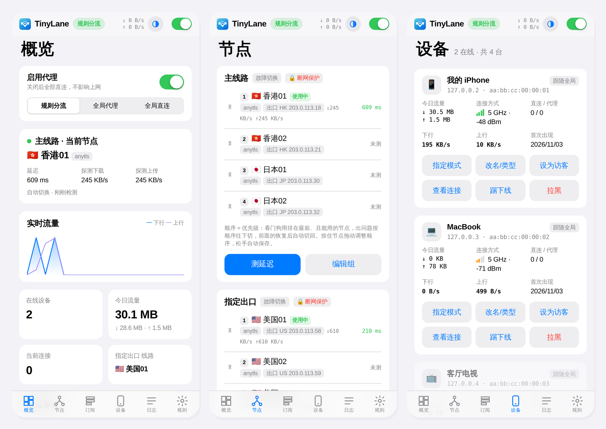
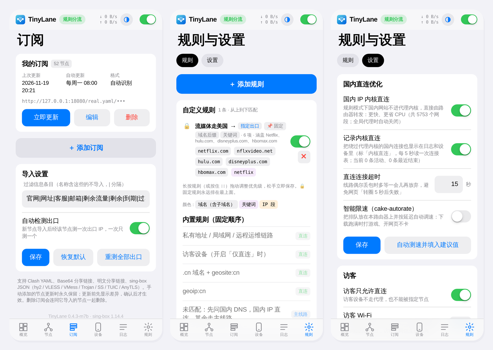

<p align="right"><b>简体中文</b> · <a href="README.en.md">English</a></p>

<p align="center">
  
</p>

<h1 align="center">TinyLane</h1>

<p align="center"><b>小路由器的全家透明代理 · 一个二进制，装上就分流</b></p>

<p align="center"><i>256 MB 内存也跑得稳：sing-box 内核 + 守护进程 + 手机面板，全在一个文件里。</i></p>

<p align="center">
  <a href="../../releases"></a>
  <a href="LICENSE"></a>
  
  
  
  <a href="CHANGELOG.md"></a>
</p>

<p align="center">
  <a href="#适合谁">适合谁</a> ·
  <a href="#功能说明">功能说明</a> ·
  <a href="#安装">安装</a> ·
  <a href="#常用命令">常用命令</a> ·
  <a href="#已知局限">已知局限</a> ·
  <a href="#自己编译">自己编译</a> ·
  <a href="CHANGELOG.md">更新记录</a>
</p>

<p align="center"></p>

<details>
<summary>更多截图（订阅 · 规则 · 设置）</summary>
<p align="center"></p>
</details>

<p align="center"><sub>截图为演示数据</sub></p>

> 早期版本，作者在小米 AX3000T（OpenWrt 25.12，256 MB）上每天自用并持续更新，自用时观测到的常驻内存约为内核 35 MB、面板 20–28 MB，路由器可用内存 77–93 MB（一台路由器、家庭日常负载下的读数，未与 OpenClash 做同机对比测试）。每次更新的改动写在 [CHANGELOG.md](CHANGELOG.md) 和 Release 说明里。

## 适合谁

- 路由器内存只有 128–256 MB，跑 OpenClash 之类太吃力；
- 想让家里所有设备（电视、游戏机、访客手机）自动分流，而不是一台台装软件；
- 想在手机上随时看到：现在走哪条线路、哪台设备在用流量、哪个网站走了代理还是直连。

## 功能说明

### 1. 三种上网模式

面板顶部一键切换：

| 模式 | 效果 |
|---|---|
| 规则分流（默认） | 国内网站和国内 IP 直连，其余按规则走代理 |
| 全局代理 | 除了标了「固定」的规则，全部走主线路 |
| 全局直连 | 代理不工作，相当于普通路由器 |

「启用代理」开关关掉后全部设备直连上网，路由器本身照常工作。

### 2. 节点、订阅和分组

- **订阅**：粘贴订阅地址即可，支持 Clash YAML、sing-box JSON、分享链接 / Base64；支持 Hysteria2、VLESS（含 Reality、WS+TLS）、AnyTLS 等协议。可设每天 / 每周自动更新，更新前先显示「新增 / 删除了哪些节点」，确认后才应用。订阅里「剩余流量」「到期时间」这类假节点会按关键词自动过滤。
- **手动节点**：贴一条分享链接就能加。
- **出口检测**：每个节点自动测出实际出口所在地区，显示在节点旁边。
- **分组**：每个组 = 手动勾选的节点 +「名称包含 XX 就自动加入」+「名称包含 XX 就排除」。订阅更新、删节点后组成员自动重算，不用重新勾。
- **故障切换**：组内节点按顺序排优先级，看门狗同时测延迟和下载速度，当前节点不行就自动切到下一个，恢复后切回；如果是宽带本身断了，则不会乱切。也可以点节点名手动锁定。
- **断网保护**：给某个组打开后，这个组的节点全部不可用时，宁可断开也不会改走直连或其他线路。适合「某些网站只能从指定地区访问」的场景。

### 3. 规则分流

- **自定义规则**：按域名、域名后缀、关键词、IP 段、端口、来源设备匹配，去向可选任意组、直连或拦截。长按拖动调整优先级；标「固定」的规则在全局代理模式下也生效。
- **远程规则集**：支持 .srs 和 sing-box 源格式 .json，按计划自动更新。
- **快捷规则**：在连接列表里看到某个网站，点一下就能加成「以后直连」或「以后走某组」。
- **国内 IP 内核直连**：国内 IP 在防火墙层直接放行，不经过代理内核，省 CPU、速度更稳。
- **导入**：可直接粘贴 Clash 规则行、域名列表或整份配置，先预览再选择应用到哪个组。

### 4. 设备管理

- 自动发现局域网设备，显示类型、在线 / 休眠 / 离线、Wi‑Fi 信号、今日流量（包括直连流量）。
- 每台设备可以单独指定模式（需要给设备设固定 IP）：
  - 跟随全局 / 全局代理 / 全局直连；
  - **国内直连，国外走某组**：国内网站和国内 IP 照常直连，其余走你选的组。例如 iPhone 国外走美国组、Mac 国外走日本组；
  - **全部走组（含国内）**：这台设备的所有流量（包括国内网站）都走该组。
  - 你写的自定义规则仍然优先于设备模式。
- **访客**：标成访客的设备只能直连上网；可设置「新设备默认算访客」。
- **拉黑**（路由器丢弃这台设备的所有流量）、**踢下线**（Wi‑Fi 设备断开一次，或禁止 5 分钟 / 1 小时 / 24 小时内重连）。
- **查看连接**：一键看这台设备正在连哪些网站、走的哪条线路。

### 5. 连接与日志

- 实时连接列表：按设备或全部查看，搜索域名 / 应用 / 节点，可暂停滚动。
- 每条连接显示走了「代理 / 直连 / 内核直连 / 拦截」以及具体节点。
- 24 小时连接历史和按应用分类的视图（抖音、微信、B 站等常见应用自动归类）。
- 记录只放在内存里，不写闪存，重启后清空。

### 6. 国内直连优化（可选）

- WAN 口启用 cake 队列，配合 [cake-autorate](https://github.com/lynxthecat/cake-autorate) 根据延迟自动调整上下行速度，减少打游戏、视频通话时的卡顿。
- 面板里有「自动测速并填入建议值」。宽带带宽不稳定（比如合租共享）的话建议先保持关闭。
- 直连连接超时时间可调。

### 7. 访客 Wi‑Fi（可选）

独立的 Wi‑Fi 名称和密码，访客只能上网，看不到家里的其他设备。开启时会自动检查主 Wi‑Fi 和远程管理链路，任何一项不正常就自动撤回。开启过程中 Wi‑Fi 会断开 10–30 秒。

### 8. 稳定性与安全

- **自我保护**：代理内核 2 分钟内崩溃 3 次，会自动撤掉透明代理、让全家临时直连上网，内核恢复稳定后自动切回。面板和内核是两个进程，内核出问题面板照常能打开。
- **内存保护**：内存紧张时优先保住代理内核；可用内存低于 40 MB 时拒绝测速，避免把路由器拖死。
- **运维链路直连**：路由器本机流量、WireGuard 等远程管理链路永远直连，可在编译时写死，配置里删不掉，避免把自己关在门外。
- **安全试运行**：首次安装或大改配置时用 `tinylane-safe-apply 5` 启动——5 分钟内不执行 `tinylane-safe-apply confirm` 确认，就自动退回普通路由。试运行期间会临时关掉开机自启（确认后恢复），所以这段时间路由器断电重启也会回到普通路由。局限：计时器是普通后台进程，如果路由器卡死却没有重启，不能保证按时回滚。
- **高级模式**：可以直接编辑原始 JSON 配置，保存前完整校验并标出错误行号；应用后 90 秒内不确认会自动回滚。

### 9. 面板

- 手机优先的 iOS 风格界面，支持浅色 / 深色 / 跟随系统，可选强调色；整个面板压缩后约 36 KB，内嵌在二进制里。
- 地址：`http://<路由器 IP>:9999`，或 LuCI「服务 → TinyLane」（已登录 LuCI 时自动登录）。也可以单独设置面板密码。
- 概览页显示实时速度、在线设备、今日流量、主线路状态、内存占用和最近事件。

## 安装

> 目前只提供 linux/arm64 预编译版（在 AX3000T 上测试）。其他架构请自行编译。

1. **装依赖**
   ```sh
   apk add kmod-nft-tproxy dnsmasq-full curl ca-bundle
   # 可选（智能限速）：
   apk add kmod-sched-cake kmod-ifb tc-tiny fping
   ```
2. **放程序**：从 [Releases](../../releases) 下载 `tinylane-<版本>-linux-arm64`，放到 `/usr/bin/tinylane` 并 `chmod +x`。
3. **放配套文件**：把仓库里 `files/` 下的文件按原路径复制到路由器（启动脚本、防火墙脚本、LuCI 菜单等）。
4. **写配置**：复制 `files/etc/tinylane/tinylane.json.example` 为 `/etc/tinylane/tinylane.json`，填入你的订阅或节点。也可以先留空，装好后在面板里添加。
5. **安全试运行**：
   ```sh
   /etc/init.d/tinylane enable
   tinylane-safe-apply 5        # 启动，5 分钟内不确认就自动退回
   # 打开面板确认一切正常后：
   tinylane-safe-apply confirm
   ```
6. 打开 `http://<路由器 IP>:9999`。

**以后更新**（0.4.5 起）：面板 → 规则与设置 → 设置 →「更新」→ 检查更新，有新版点「立即更新」即可。路由器会先验证 Release 里的官方签名（`SHA256SUMS-arm64.txt.sig`），再换新版并自检 3 分钟，没通过自动退回旧版。自动更新默认关闭，打开后只在凌晨 4:00 更新正式版。从 0.4.4 或更早版本升到 0.4.5 需要按第 2 步手动换一次程序。

**卸载**：`/etc/init.d/tinylane disable && /etc/init.d/tinylane stop`，删除 `/usr/bin/tinylane`、`/etc/tinylane/` 和第 3 步复制的文件即可，路由器会回到普通路由。

## 常用命令

```sh
tinylane mode rule|global|direct                  # 切换模式
tinylane conns '主线路'                           # 查看某个组的当前连接
tinylane check -c /var/run/tinylane/config.json   # 校验内核配置
tinylane gen -i /etc/tinylane/tinylane.json -o sb.json --nft t.nft   # 只生成配置不启动
```

## 已知局限

- 暂不支持 IPv6 代理：IPv6 流量不经过 TinyLane，DNS 不返回 IPv6 地址。
- 连接记录、设备活动记录都在内存里，重启后清空。
- 内存数字是作者自用的观测值，还没做长时间满负载、大量连接下的峰值测量，也没有与 OpenClash 同机对比。
- 预编译版目前只有 arm64。

## 自己编译

```sh
# 需要 Go 1.25+（发布版用 1.27.4） 和 sing-box v1.14.4 源码
git clone --depth 1 --branch v1.14.4 https://github.com/SagerNet/sing-box.git /tmp/sing-box
SB=/tmp/sing-box OUT=out/tinylane-linux-arm64 GOARCH=arm64 sh build.sh
# 可选：把远程管理链路写死进二进制（逗号分隔）
TL_BUILTIN_BYPASS=203.0.113.10/32,10.0.0.0/24 SB=/tmp/sing-box sh build.sh
```

编译标签：`with_quic,with_clash_api,with_gvisor,with_utls`。

**可复现构建**：发布版用 Go 1.27.4、`CGO_ENABLED=0 -trimpath -buildvcs=false`、固定 `-ldflags`，依赖由 sing-box 的 `go.sum` 锁定，任何人按下面的方式都能编出逐字节相同的程序：

```sh
git clone --depth 1 --branch v1.14.4 https://github.com/SagerNet/sing-box.git /tmp/sing-box
V=0.4.5; mkdir -p dist
TL_RELEASE=1 SB=/tmp/sing-box OUT=dist/tinylane-$V-linux-arm64 GOARCH=arm64 sh build.sh
gzip -9 -n -k dist/tinylane-$V-linux-arm64
(cd dist && sha256sum tinylane-* | diff - ../release-sigs/v$V/SHA256SUMS-arm64.txt && echo 一致)
```

`release-sigs/v<版本>/` 里是作者签过名的 SHA256SUMS 和签名。发布 Release 时 GitHub Actions 按同样方式编译，产物的 sha256 必须和这份签名清单完全一致才会附到 Release，不一致工作流直接失败（`.github/workflows/release.yml`）。

## 目录

| 路径 | 内容 |
|---|---|
| `src/cmd/tinylane/` | 主程序（放进 sing-box 源码树的 `cmd/tinylane` 编译） |
| `src/include/` | 精简的协议注册表（只注册用到的协议，减小体积） |
| `src/patch/` | 对 sing-box 的一行补丁（DNS 应答旁路，用于给内核直连连接标域名） |
| `web/` | 面板源码，`assemble.py` 拼成单文件 |
| `files/` | 装到路由器的文件：启动脚本、防火墙 / 整形 / 访客 Wi‑Fi 脚本、安全试运行、LuCI 菜单、示例配置 |
| `test/` | 测试脚本 |
| `docs/` | 截图 |

## 致谢与许可

- [sing-box](https://github.com/SagerNet/sing-box)（GPL-3.0-or-later）：代理内核。TinyLane 与其静态链接，因此整体按 **GPL-3.0-or-later** 发布（见 LICENSE）。
- [cake-autorate](https://github.com/lynxthecat/cake-autorate)（GPL-2.0，见 `files/usr/share/cake-autorate/LICENCE.md`）。
- 面板外观参考 [gotired/apple-design-skills](https://github.com/gotired/apple-design-skills) 的设计规则和系统色值（未复制其代码）。与 Apple Inc. 无关。
- TinyLane 是独立项目，与 sing-box 官方无关，也未获其认可。
